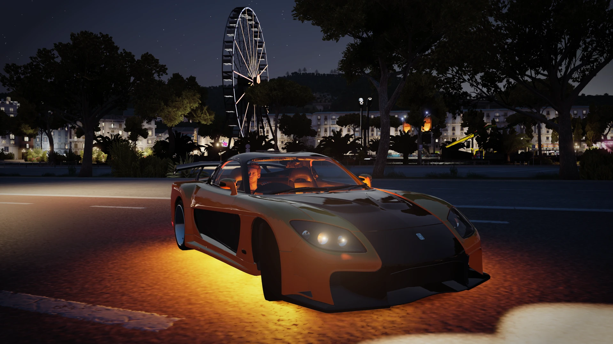
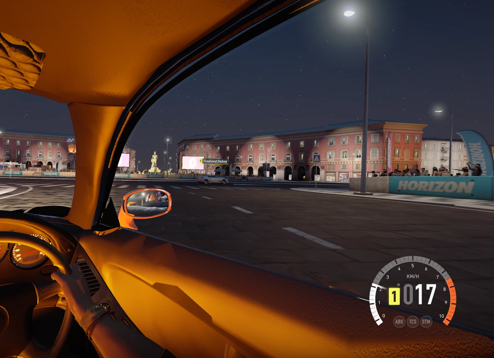
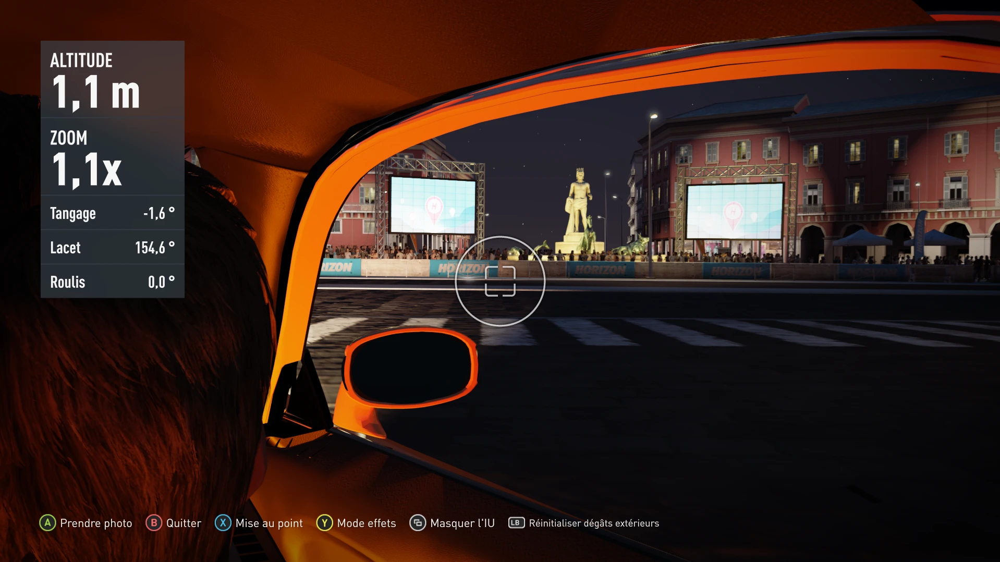
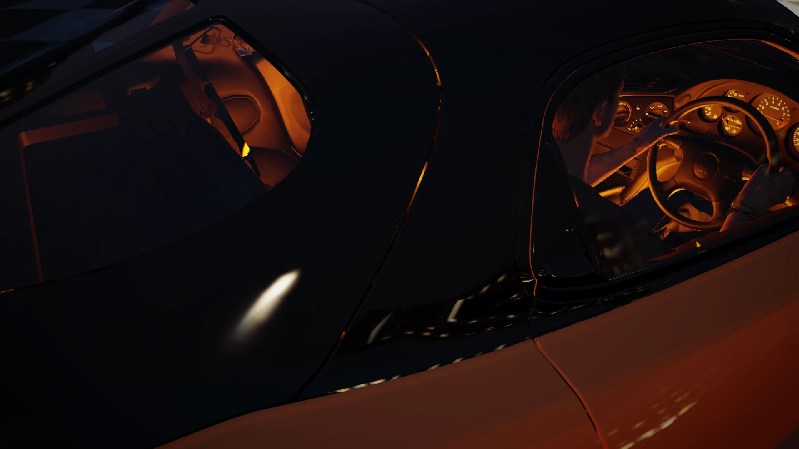

# Mazda RX-7 '92 Veilside — Fast & Furious Edition (Forza Horizon 2 PC)

Han's orange-and-black **RX-7 Veilside Fortune** from *Tokyo Drift*, added to **Forza Horizon 2** on PC as a brand new car (it does not replace the stock RX-7).

This is a port of the Forza Horizon 6 mod **[Mazda RX-7 Veilside (FH6, Nexus Mods #299)](https://www.nexusmods.com/forzahorizon6/mods/299)** — all credit for the original Veilside model goes to its author.

## Features

- **New car "RX-7 Fast & Furious Edition"** (car Id 2600), sold at the Autoshow under Mazda, with its own name and dealer pictures.
- **Full Veilside body kit**: bumpers, wide fenders, side skirts, wing, exhaust, Veilside headlights and taillights.
- **Veilside mirrors** that reflect the road in cockpit view and take the in-game mirror paint colour.
- **Han's interior mirror** from the FH6 mod.
- **Working lights**: projector headlights, red taillights at night and when braking, front and rear **turn signals**.
- **Veilside badge** on the rear panel.
- **Optional add-on — underglow**: orange neon tubes, orange ground light and orange cabin light, on with the headlights.
- **Wider track** for the Veilside stance through fh2wheels.

## Requirements

- Forza Horizon 2 running on PC with **[Azimuth](https://almost-there-games.itch.io/azimuth)** 1.0.4.
- **[Extra Options](https://github.com/RokkuDayo/ForzaHorizon2_ExtraOptions)** 0.4.4 or newer (it loads the `mods` folder).
- **[fh2wheels](https://github.com/conner-mcvay/fh2-mods)** — included here as an Extra Options plugin, already set up for this car.

## Installation

1. Download `rx7_Veilside_EN.zip` from the [Releases](../../releases) page.
2. Extract it into your Azimuth folder (the one containing `azimuth.exe`).
3. You now have three folders in `mods\`:
   - `MAZ_RX7_92 Veilside` — the car.
   - `MAZ_RX7_92 Veilside Neons` — the underglow add-on (optional; delete it if you don't want neons).
   - `fh2wheels plugin` — the wider track (`fh2wheels.ini`: `2600=40,158`).
4. Launch the game and find the car at the Autoshow (Mazda).

Extra Options adds new folders to `mods\loadorder.txt` automatically. Keep **Neons after the car**.

Tested on a clean (vanilla) Forza Horizon 2 + Azimuth 1.0.4 + Extra Options 0.4.4.

## Known issues

- **Turn damage off for this car.** Collisions can leave black patches on the kit.
- **You can see through the body a little in some places** (small gaps between kit panels, mostly at night when the cabin light is on). It is only visible up close and does not affect gameplay.
- **Cockpit view and photo mode differ around the A-pillars.** In cockpit view the game does not draw the main Veilside body, so the inner edge of the windscreen pillar shows dark instead of in the car colour (photo mode shows it correctly).
- fh2wheels can occasionally crash the game at startup on Azimuth 1.0.4; launching again works.

| Cockpit view | Photo mode | Small gaps at night |
|---|---|---|
|  |  |  |

## Credits

- Original Veilside RX-7 model: [FH6 mod on Nexus Mods (#299)](https://www.nexusmods.com/forzahorizon6/mods/299) and its author.
- [Azimuth](https://almost-there-games.itch.io/azimuth) by Almost There Games.
- [Extra Options](https://github.com/RokkuDayo/ForzaHorizon2_ExtraOptions) by RokkuDayo.
- [fh2wheels / fh2-mods](https://github.com/conner-mcvay/fh2-mods) by conner-mcvay.
- Port to Forza Horizon 2: crasyimperior.

*Forza Horizon is a trademark of Microsoft. This is a fan-made mod, not affiliated with Microsoft, Playground Games or Turn 10.*
